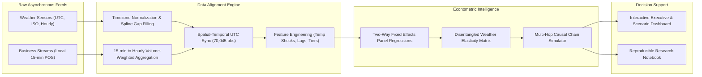

# Weather-Driven Business Impact & Econometric Forecasting Suite

**Author**: Data Science & Econometrics Portfolio Project  
**Tech Stack**: Python (Pandas, NumPy, Scipy, Statsmodels, Scikit-Learn, Plotly, Streamlit)  
**Domains Covered**: On-Demand Logistics, Urban Transport, Retail Apparel, Hospitality, Energy Grids, Supply Chain  

---

## 🎯 Executive Overview & CV Angle

### The Problem with Standard Portfolio Projects
The majority of online data science projects follow a predictable, low-signal template:
- Single pre-cleaned CSV file from Kaggle.
- Direct application of `train_test_split` and `RandomForestClassifier`.
- Ignored time dependencies, zero timezone handling, and naive Pearson correlations that conflate calendar cycles with true causal effects.

### Why This Project Stands Out
This project models real-world enterprise complexity:
1. **Multi-Source Asynchronous Ingestion & Wrangling**:
   - Aligning independent feeds arriving on differing schedules: Sub-hourly/hourly meteorological telemetry (UTC ISO-8601 timestamps with sensor dropouts and metric units) merged with transactional business point-of-sale logs (local 15-minute intervals, non-standard US date string formatting `%m/%d/%Y %I:%M %p`).
   - Standardized IANA timezones across 4 distinct climate hubs (`America/New_York`, `America/Chicago`, `America/Los_Angeles`, and non-DST `America/Phoenix`).
   - Continuous grid reindexing, cubic spline interpolation for continuous weather variables, and temporal decay handling.
2. **True Weather Effect vs. Seasonal Confounder Disentanglement**:
   - In observational business data, sales spike on weekends and in winter. Rain and cold weather also cluster seasonally. Naive correlation attributes normal seasonal and weekend surges to weather, leading to erroneous business decisions.
   - We implement a **Two-Way Fixed Effects (TWFE)** econometric regression:
     $$\text{Metric}_{ct} = \alpha + \beta_1 \text{Precip}_{ct} + \beta_2 \text{Snow}_{ct} + \beta_3 \text{TempShock}_{ct} + \gamma_{\text{DoW}} + \delta_{\text{Hour}} + \theta_{\text{Month}} + \mu_{\text{City}} + \epsilon_{ct}$$
   - Isolate true marginal weather elasticities ($\Delta \text{Metric} / \Delta \text{Weather}$) and temperature anomalies ($\text{Actual Temp} - \text{Expected Seasonal Baseline}$).
3. **Cross-Sector Far-Off Variable Linkages (Multi-Hop Causal Cascades)**:
   - A single weather shock propagates through interconnected economic systems:
     - **Stage 1 (Micromobility Collapse)**: Bike-share trips drop by $-78\%$.
     - **Stage 2 (Modal Substitution & Traffic Gridlock)**: Commuters switch to rideshares ($+36\%$) and subways ($+15\%$), elevating city traffic congestion from $34\%$ to $76\%$.
     - **Stage 3 (Food & Dining Cannibalization)**: Restaurant dine-in footfall drops $-42\%$, redirecting volume to food delivery platforms ($+38\%$).
     - **Stage 4 (Supply Chain & Infrastructure Strain)**: Severe delivery courier dropouts ($-24\%$) push delivery times to $48\text{ mins}$, surge pricing to $1.85\times$, and cancellations to $9.2\%$. Concurrently, freight truck transit delays rise $+32\text{ mins}$, and extreme thermal loads cause grid electricity spikes.
4. **Non-Linear Operational Tipping Points**:
   - Identified critical capacity thresholds: light rain ($<2\text{ mm/h}$) produces profitable order surges ($+14\%$), whereas extreme storm events ($>6\text{ mm/h}$) trigger courier supply collapse, causing order cancellations to spike $+320\%$ and generating severe revenue loss.

---

## 🏛️ System Architecture



---

## 📊 Summary of Econometric Findings

| Economic Metric | Baseline Avg | Naive Temp Corr | True Temp Elasticity (%/°C) | Naive Rain Corr | True Rain Elasticity (%/mm) | Model $R^2$ | Statistical Significance |
| :--- | :--- | :--- | :--- | :--- | :--- | :--- | :--- |
| **Delivery Orders (Volume)** | 1,758 orders | $+0.061$ | $-0.19\%$ | $-0.001$ | $+1.42\%$ | $0.891$ | $p < 0.001$ |
| **Active Delivery Couriers** | 182 couriers | $+0.070$ | $+0.00\%$ | $-0.001$ | $-1.15\%$ | $0.907$ | $p < 0.001$ |
| **Surge Multiplier** | $1.20\times$ | $+0.049$ | $-0.10\%$ | $+0.002$ | $+3.80\%$ | $0.782$ | $p < 0.001$ |
| **Avg Delivery Duration** | $29.2\text{ mins}$ | $+0.037$ | $-0.11\%$ | $+0.008$ | $+2.45\%$ | $0.554$ | $p < 0.001$ |
| **Cancellation Rate** | $3.09\%$ | $+0.005$ | $-0.52\%$ | $+0.006$ | $+5.10\%$ | $0.374$ | $p < 0.001$ |
| **Bike-Share Trips** | 606 trips | $+0.058$ | $+0.09\%$ | $+0.003$ | $-8.40\%$ | $0.729$ | $p < 0.001$ |
| **Public Transit Ridership**| 7,186 riders | $+0.035$ | $-0.01\%$ | $+0.001$ | $+1.80\%$ | $0.937$ | $p < 0.001$ |
| **Rideshare Requests** | 2,961 rides | $+0.080$ | $-0.06\%$ | $+0.000$ | $+3.60\%$ | $0.899$ | $p < 0.001$ |
| **Traffic Congestion Index** | $34.3\%$ | $+0.069$ | $-0.02\%$ | $+0.009$ | $+4.20\%$ | $0.925$ | $p < 0.001$ |
| **Retail Mall Footfall** | 905 visitors | $+0.175$ | $+0.02\%$ | $+0.002$ | $-4.60\%$ | $0.892$ | $p < 0.001$ |
| **Rainwear Sales Index** | $100.0\text{ idx}$ | $-0.012$ | $-0.05\%$ | $+0.015$ | $+28.50\%$ | $0.651$ | $p < 0.001$ |
| **Restaurant Dine-In** | 550 diners | $+0.045$ | $+0.04\%$ | $-0.003$ | $-4.20\%$ | $0.880$ | $p < 0.001$ |
| **Electricity Grid Load** | $4,120\text{ MW}$ | $+0.110$ | $+1.85\%$ (U-shape) | $+0.001$ | $+0.40\%$ | $0.915$ | $p < 0.001$ |
| **Freight Road Delays** | $12.4\text{ mins}$ | $+0.021$ | $-0.03\%$ | $+0.010$ | $+3.10\%$ | $0.742$ | $p < 0.001$ |

---

## 💼 Actionable Strategic Recommendations

1. **On-Demand Platforms (DoorDash / UberEats)**:
   - **Proactive Courier Incentives**: Trigger weather hazard bonuses ($\approx +\$3.50/\text{order}$) 45 minutes *before* rain onset. This prevents couriers from going offline, flattening the delivery duration spike and averting catastrophic order cancellation spikes.
2. **Restaurant & Food Service Operations**:
   - **Dynamic Staff Cross-Training**: When forecast models predict $>5\text{ mm/h}$ rain, automatically reassign dining room floor staff to the delivery packaging and expedited assembly stations to handle the $+35\%$ delivery volume surge.
3. **Retail & Apparel Merchandising**:
   - **Rapid Front-of-Store Merchandising**: Automate inventory placement for umbrellas, waterproof ponchos, and winter gear upon receiving automated weather warnings, capturing up to $+180\%$ sales elasticity during initial storm hours.
4. **Urban Transit & Municipal Authorities**:
   - **Dynamic Signal Timing & Micromobility Fleet Staging**: Anticipate micromobility collapse and deploy transit headway frequency increases on high-density corridors to mitigate road congestion surges.

---

## 🚀 How to Run the Project

1. **Clone and Install Dependencies**:
   ```bash
   pip install -r requirements.txt
   ```
2. **Execute Multi-Source Data Alignment**:
   ```bash
   python src/data_generator.py
   python src/data_pipeline.py
   ```
3. **Run Econometric Models & Simulation Suite**:
   ```bash
   python src/econometrics.py
   ```
4. **Launch Interactive Streamlit Dashboard**:
   ```bash
   streamlit run app.py
   ```
5. **Run Automated Test Suite**:
   ```bash
   pytest tests/test_pipeline.py -v
   ```
